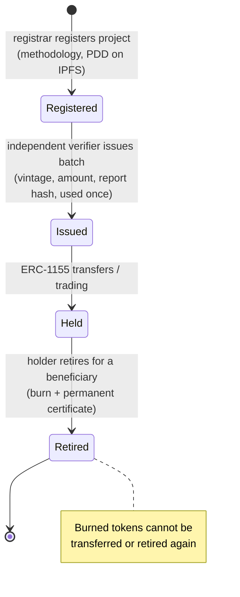

# carbon-credit-registry-solidity

**On-chain carbon credits that can be issued only against a verified report, traded freely, and retired
exactly once, with a public certificate.**

This is a Solidity (ERC-1155) reference for nature-based carbon markets. It addresses the hardest
integrity problem in carbon markets: **double counting**.

[](../../actions/workflows/ci.yml)


## Lifecycle



## Integrity controls

| Risk | Control | Test |
|---|---|---|
| Same monitoring period issued twice | Each verification-report hash can be used once | `rejects reuse of a verification report` |
| Self-certification | A verifier cannot issue for a project it develops | `a verifier cannot certify its own project` |
| A tonne claimed twice | Retirement burns the credits and records a certificate | `cannot retire more than you hold…` |
| Anonymous offset claims | A beneficiary is mandatory on every retirement | `requires a beneficiary for retirement` |
| Unauthorised minting | Role-based access (`REGISTRAR`, `VERIFIER`, `PAUSER`, admin) | `only verifiers can issue` |
| Incident (key compromise, bad issuance) | Pause freezes issuance, transfers and retirement | `pausing freezes…` |
| Invalid data | Zero amounts, future vintages and inactive projects are rejected | `rejects inactive projects…` |

## Run

```bash
npm install
npx hardhat test
npx hardhat run scripts/deploy.js --network hardhat
```

## Design notes

- **ERC-1155, one token id per issuance batch** (project + vintage). Batches are fungible within
  themselves and distinguishable across vintages, which is how buyers price credits.
- **The heavy data lives off-chain.** Project design documents and verification reports are stored on
  IPFS or a registry; only hashes and URIs go on-chain.
- **Governance:** move `DEFAULT_ADMIN_ROLE` to a multisig behind a timelock immediately after
  deployment. Verifier onboarding should mirror real accreditation, and verifiers should be known entities.
- **Not covered here, needed in production:**
  - an external audit
  - bridging to and from registries such as Verra and Gold Standard, with matching cancellation on the source registry
  - corresponding adjustments under Article 6
  - KYC on retirement beneficiaries where required
  - an upgrade strategy (UUPS proxy or migration)

> This is a reference implementation for architecture discussion. It has **not been audited**.
> Do not use it with real value without a professional security audit.

---
Author: [Rubbaite T. Hassain](https://tanvir.info.bd) ([LinkedIn](https://www.linkedin.com/in/rubbaite)) · Software Architect, Founder of [Datazo InfoTech](https://www.datazoinfotech.com.bd) · MIT License
